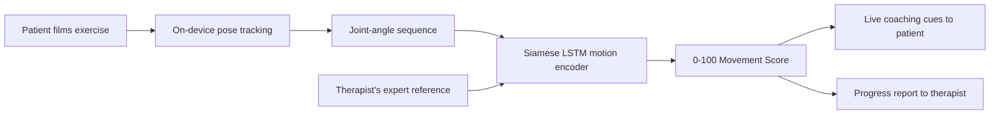

# 🔎 RehabLens

**Your physical therapist's eyes at home.**

RehabLens is an AI form-coach for physical therapy: point any phone camera at a
patient doing their home exercises, and RehabLens scores their movement against
the therapist's expert reference — in real time — then reports progress back to
the clinic.

A Conrad Challenge entry (Health & Nutrition category).

[](LICENSE)
[](prototype/)
[](docs/demo/)

---

## The moment that started it

Maria is 63. Three weeks after knee-replacement surgery, her physical therapist
taught her six exercises and sent her home with a printed sheet. Maria does her
exercises every single day — she is one of the motivated ones. But nobody can
see that her knee drifts inward on every squat, and she never quite bends it to
the angle the therapist asked for.

At her four-week follow-up, the therapist is puzzled: the exercises were
supposed to be working. Range of motion has stalled. A recovery that should
take 8 weeks will now take 14 — more pain, more visits, more cost. And it
happened in plain sight, three feet from a camera lens, every single day.

**The therapist was blind between visits. RehabLens opens her eyes.**

## The problem

Physical therapists prescribe home exercise programs (HEPs) after nearly every
injury and surgery, but between weekly or bi-weekly clinic visits they have no
way to see whether patients are doing the exercises — let alone doing them
*correctly*.

The evidence is blunt:

- Only about **35% of PT patients fully adhere** to their home exercise
  programs; non-adherence runs as high as **70%** ([Argent et al. 2018](https://pmc.ncbi.nlm.nih.gov/articles/PMC5856927/), [Physio-pedia](https://www.physio-pedia.com/Adherence_to_Home_Exercise_Programs)).
- Even motivated patients perform exercises with silent form errors —
  reduced range, knee valgus, compensation patterns — that slow recovery and
  raise re-injury risk.
- Demand is exploding: the U.S. PT services market is **$52B+ and growing
  ~5–10% annually** ([Grand View Research](https://www.grandviewresearch.com/industry-analysis/us-physical-therapy-services-market-report)), while the PT workforce cannot keep up
  ([APTA: demand +14.7% by 2037](https://www.apta.org/contentassets/787bafc2ef664074ace8914f748ee4cd/apta-2025-workforce-forecast-companion-report.pdf)).

The result: longer recoveries, more clinic visits, worse outcomes — and a
therapist who only finds out weeks later.

## The solution

RehabLens turns any smartphone into a personal PT assistant that lives between
clinic visits:

1. **Film.** The patient films their exercise with any phone camera. Nothing
   to wear, nothing to strap on.
2. **Score.** On-device pose AI tracks their joints, and a movement model
   compares their *entire motion sequence* to the therapist's expert reference,
   producing a 0–100 Movement Score plus live coaching cues ("bend your knee
   15° more", "keep your knees over your toes", "slow down").
3. **Report.** Every session becomes a progress report — range of motion,
   reps, scores, and a trend chart — delivered to the patient and the
   therapist's dashboard. The therapist sees what happens between visits, and
   the clinic can bill Medicare **Remote Therapeutic Monitoring** codes
   (98975/98977) for the monitoring RehabLens makes possible.



## Why this is innovative

Existing tools do two things: wearables count reps, and telehealth apps play
videos. **RehabLens scores the quality of the movement itself.**

Our prototype doesn't compare single joint snapshots — it compares the
*sequence* of motion. A Siamese bidirectional LSTM encodes the patient's
movement and the therapist's reference into the same embedding space, so the
score captures timing, coordination, depth, and compensation patterns, not
just "did the knee bend far enough."

**Prototype validation (see [prototype/](prototype/)):**

| Test | Result |
|---|---|
| Same exercise, two recordings (bridge vs bridge) | **99.5 / 100** |
| Different exercises (bridge vs squat, negative control) | **0.0 / 100** |
| Augmented-pair classification accuracy (20 clips, 12 movements) | **94.2%** |

The [live demo](https://pumaduma.github.io/RehabLens/demo/) brings the same idea to the browser with real-time
MediaPipe pose tracking, digital goniometry, rep counting, and form scoring —
all processed **on-device, with no video leaving the phone**.

## Try it now

**Option A — live demo (no install):** the demo runs entirely in your browser.

1. Open the hosted demo at
   **[pumaduma.github.io/RehabLens/demo](https://pumaduma.github.io/RehabLens/demo/)** —
   allow camera access, pick an exercise, and move, or
2. Open [`docs/demo/index.html`](docs/demo/index.html) locally on your computer
   or phone (camera access needs `https://` or `localhost`, so the hosted
   version is recommended).

**Option B — research prototype (Python):** the full YOLO Pose + Siamese LSTM
pipeline that produces the scores above.

```bash
cd prototype
python3 -m venv .venv && source .venv/bin/activate
pip install -r requirements.txt
python dataset_tools/compare_rehab_videos.py \
  --standard <expert_video.mp4> --user <your_video.mp4>
```

See [`prototype/README.md`](prototype/README.md) and
[`prototype/DATASET_WORKFLOW.md`](prototype/DATASET_WORKFLOW.md) for details.

## Repository map

| Path | What's inside |
|---|---|
| [`docs/`](docs/) | Competition documents: Innovation Brief, business plan, market research, safety case, ethics, roadmap |
| [`docs/demo/`](docs/demo/) | Browser demo — real-time pose tracking, goniometry, rep counting, movement scoring (on-device) |
| [`prototype/`](prototype/) | Research pipeline — YOLO Pose → joint angles → Siamese LSTM movement scorer (PyTorch) |
| [`dataset/`](dataset/) | Reference exercise clips, manifests, and raw data with licences and consent notes |
| [`pitch/`](pitch/) | Pitch deck and presentation assets |

## Documentation

- 📋 **[Innovation Brief](docs/innovation-brief.md)** — our answers to the Conrad Stage 2 brief questions (the document that decides who advances).
- 💼 **[Business Plan](docs/business-plan.md)** — problem, solution, market, unit economics, 3-year financials.
- 📊 **[Market Research](docs/market-research.md)** — every number, with sources.
- 🛡️ **[Clinical Safety](docs/clinical-safety.md)** — what the prototype can and cannot do, and our validation plan (limitations as a safety case).
- 🔒 **[Data Ethics](docs/data-ethics.md)** — privacy, consent, and responsible AI.
- 🗺️ **[Roadmap](docs/roadmap.md)** — 24-month plan from prototype to pilot to product.
- 🏆 **[Competition Guide](docs/competition-guide.md)** — how this repo maps to each Conrad stage, including the 90-second video script.

## Team

| Role | Member |
|---|---|
| Machine learning & computer vision | *(your name)* |
| Product & UX | *(your name)* |
| Business & finance | *(your name)* |
| Clinical advisor (coach) | *(your coach)* |

*Team of 2–5 students aged 13–18, plus one adult coach, as required by the
Conrad Challenge.*

## Safety & ethics

RehabLens is a **classroom research prototype**. It measures visible 2D motion
similarity and is **not** a medical device, a diagnosis, or proof that an
exercise is safe. Scores are designed to flag "please check this with your
therapist," never to prescribe. All demo processing happens on-device; the
prototype's human-review workflow keeps a qualified clinician in the loop.
See [`docs/clinical-safety.md`](docs/clinical-safety.md) and
[`docs/data-ethics.md`](docs/data-ethics.md).

## License

Code: [MIT](LICENSE). Dataset videos remain under their original licences
(Pexels, UCSF, Cambridge University Hospitals) — see the manifests in
[`dataset/`](dataset/).
